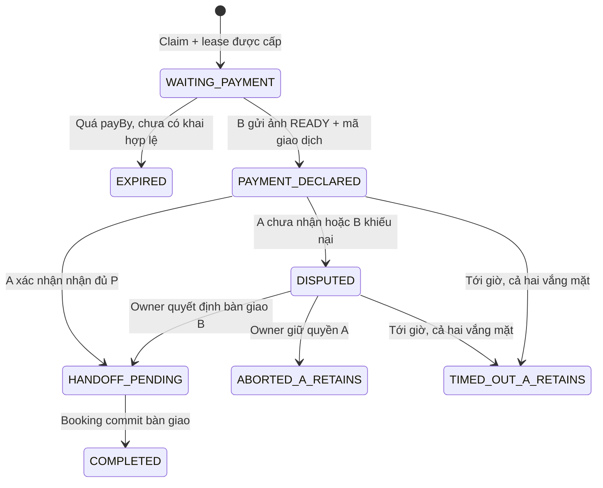

# Design

## Revision 27 — explicit interval selection and last-minute groups (2026-10-28)

Customer selects start/end from server-provided 30-minute availability boundaries; contiguous free ranges are displayed and polled every 5 seconds with the shared visibility/abort-aware polling hook. Refresh preserves input but invalidates an occupied selection. No hold is created until confirmation. Quotes and holds remain authoritative at the server.

For facilities without published hourly pricing, ScheduleReads uses FlexiblePricingEngine in PRORATED_SLOT_INTERVAL_V1 mode. Partition at price and opening-window boundaries; each piece uses the existing pricePerSlot / effective slotMinutes. Use exact integer fractions with a common denominator and round the total once; displayed pieces sum to that total. Do not mutate stored prices or historical bookings. A pre-upgrade hold without a hash can still create a booking only after scope and the accepted total are revalidated. Published HOURLY pricing retains its current precedence and revision checks.

GroupService default minimum lead becomes 900 seconds. Cap its payment deadline at startsAt minus 300 seconds, retaining the 1800-second maximum window and synchronizing reservation, booking and admission claim expiry. Existing groups retain their deadlines. Payable exposes groupOrganizerPayment only from server ownership. Under the payment booking lock, the organizer may expire an unpaid SePay member order and create a new payer-specific order for the same obligation. Refuse replacement after any bank credit; never mutate the payer on existing evidence. Existing obligation settlement and unapplied-funds processing handle delayed and duplicate transfers. The group screen presents the total shortage and per-member payment actions.

## Context

Cập nhật 28/10/2026 (mục 26): BookingDetail chỉ render ảnh QR và mã thủ công 10 ký tự, không render token trong details/text. Token/signature vẫn phục vụ QR scanner và kiểm tra hạn/holder/version. Xóa BookingPolicyCancellation và controller; route không tồn tại trả404 qua xử lý NoResourceFoundException chung. Xóa create/quote/edit/acquire cũ trong TransferService, FacilityTransferQuotes, client phí/beneficiary không còn caller và cấu hình timeout cũ. Giữ reader/payable/cancel phiên chưa trả, workflow đối soát lịch sử và guard chặn gọi protocol cũ bằng giao dịch P2P. HistoricalTransfers/fixture refund chỉ ở test; không giữ service tạo giao dịch cũ để dựng dữ liệu test. Bỏ E2E DEMO yêu cầu tạo fee/refund mới; coverage bảo mật, payment proof, outbox và lịch sử chuyển sang các bộ test hiện hành.

Cập nhật 28/10/2026 (mục 25): tái sử dụng ownerId từ Facility service làm nguồn xác định chủ cơ sở, không suy từ vai trò OWNER toàn hệ thống. BookingDependencies.requireExternalCustomer kiểm dữ liệu cơ sở hợp lệ và khác người đặt; không đọc được/thiếu ownerId trả503, chính chủ trả403. BookingHolds kiểm trước cấp giữ chỗ và khi replay; BookingCreation kiểm lại khi tạo từ hold, dùng cả cho nhóm, và kiểm linkedCustomer của quầy để tránh lách bằng số điện thoại. Khách vãng lai holder=NULL không áp điều kiện này. Đọc/replay booking đã tạo và đối soát giao dịch có sẵn giữ nguyên, không hủy hoặc đổi lịch sử.

FE dùng ownerId đã tải để chặn nút đặt cá nhân tại cơ sở mình và dẫn vào Owner counter/check-in. Thêm /owner/counter-booking và /owner/counter-booking/[courtId], tái sử dụng CounterPage/CounterSlots; chọn trong cơ sở thuộc Owner, kiểm access trước mở chọn giờ. Toolbar vận hành dùng workspace Owner/Staff đúng vai trò. Menu desktop/mobile và sidebar có liên kết rõ ràng. Quầy giữ createdBy=operator, holder=Customer hoặcNULL; dùng chung SePay/kiểm đủ tiền và check-in hiện hành, không tạo luồng thanh toán giả hoặc cấp mã khách cho Owner. Gỡ thông báo tỷ lệ hoàn chính sách cũ còn sót ở chọn giờ tại quầy theo mục24.

Cập nhật 28/10/2026 (mục 24): bỏ form hủy theo chính sách ở danh sách/chi tiết vận hành và xóa calculator/creator REAL/DEMO không còn dùng. Hai endpoint cancellation-quote/cancel-with-policy đã được xóa theo mục26 (trả404), không replay thao tác cũ hoặc tạo quote/nghĩa vụ mới. Hủy giữ chỗ chưa thu tiền chỉ còn của chính Customer hoặc người tạo nháp tại quầy, không cấp quyền hủy booking người khác bằng quyền vận hành. Giữ reader/executor nghĩa vụ cũ và xử lý thu lỗi; không migration hoặc sửa tiền/trạng thái có sẵn.

Mã 10 ký tự là credential check-in thủ công, khác khóa ký QR của server. BookingReads chỉ trả bookingCode cho currentHolder có CUSTOMER; facility list/search và operations luôn che mã, token/QR vận hành cũng bị che kể cả actor có hai vai trò. Mutation/replay của Staff không trả mã. GroupState vốn không xuất mã booking; QR thành viên giữ ACL riêng. Owner/Staff nhập mã hoặc quét QR khách xuất trình. Khách OFFLINE_COUNTER holder=NULL dùng POST /bookings/{id}/check-in-guest, không có mã trong response; từ chối online/linked Customer, kiểm BOOKING_CHECK_IN đúng cơ sở, trạng thái, chứng từ đủ tiền tại BookingLifecycle, transfer freeze và giờ chơi như luồng chung. CHECKED_IN không đổi.

Cập nhật 28/10/2026 (mục 23): gỡ dashboard khoản cơ sở trả/hoàn của Customer trên booking, nhóm và chuyển nhượng; xóa ParticipantMoney REAL/DEMO cùng dynamic wrapper/callers và các GET chỉ phục vụ hiển thị. Các API dữ liệu, nghĩa vụ cũ và công cụ đối soát/chi trả của Owner/Staff không đổi.

Làm rõ 27/10/2026 (mục 22): chỉ ngân hàng của cơ sở là điều kiện nhận tiền đặt sân; không kiểm Customer có tài khoản ngân hàng khi đặt sân hoặc mua lại. Seller phải có ngân hàng trước khi đăng chuyển nhượng. GET kênh SePay chưa cấu hình trả HTTP204, không trả HTTP200 với envelope thiếu data do bỏ null; frontend cho nhập/lưu lần đầu. Lỗi thiếu kênh phải chỉ rõ Owner cần cấu hình tài khoản cơ sở. Menu desktop/mobile dẫn tới ngân hàng nhận chuyển nhượng, vẫn giữ khóa đổi ngân hàng theo trách nhiệm và quyền sở hữu cơ sở.

Quyết định mới nhất 27/10/2026: SePay thay payOS cho khoản thu đặt sân mới; webhook API Key khớp kênh/receiver revision và dữ kiện ngân hàng mới ghi nhận đủ tiền. QR P2P vẫn B→A và xác nhận hai bên, không có phí cơ sở. Không còn Customer tự hủy booking đã thanh toán; DEMO/legacy chỉ giữ lịch sử và tiếp tục phiên đã mở, không tạo thêm giao dịch theo phí cũ. Các mô tả cutover/payOS trong phần điều tra ban đầu bên dưới chỉ phục vụ dữ liệu cũ khi xung đột với quyết định này.

Xem proposal để biết phạm vi và các lựa chọn người dùng đã chốt ngày25/10/2026. Đây là kế hoạch, chưa có implementation hoặc migration mới.

Những ràng buộc đọc từ source hiện tại:

- `ScheduleReads.quote` ghép các slot preview và từ chối khoảng không trùng slot; `PricingEngine` đã có precedence/ambiguity theo sân, loại sân, ngày và priority. Bảng giá dùng `pricePerSlot`, chưa phải giá/giờ độc lập lịch.
- `BookingHolds` khóa theo caller/court, giữ mặc định600 giây, giới hạn mặc định5 hold và10 segments. PostgreSQL đã chống giao nhau bằng khoảng `[startsAt,endsAt)`. Giới hạn số segment không thể thay thế giới hạn số phút sau nâng cấp.
- `TransferService` và Booking lease hỗ trợ một buyer đang khóa, nhưng chưa có chat/tranh chấp; complete hiện dựa trên payment có chứng từ của protocol cũ. Legacy decision COMPLETED có CHECK yêu cầu paymentId, không được nhét xác nhận A vào đó như bank payment.
- `BookingLifecycle` giữ CONFIRMED→CHECKED_IN→COMPLETED; kiểm tiền sân gốc trước check-in. `BookingUsage` chặn lease LOCKED. Các snapshot giá/tiền gốc bất biến.
- Các creator/calculator hủy theo chính sách (`RealRefundBasis`, `RealBookingCancellation`, `BookingRefundEligibility`) đã bị gỡ ở mục 24. Không thêm base hoàn mới theo giá resale hoặc quyền hủy policy để thay thế; chỉ giữ xử lý thu lỗi và nghĩa vụ lịch sử.
- Gateway hiện giới hạn theo IP; `GatewayIdentity` chỉ chứa userId/email/roles. Không được suy ACTIVE hoặc verified từ việc có JWT hay tin header client tự gửi.
- Đã có social chat cho play group, MinIO/JPEG-PNG validation và bank destination revisions. Chat nhóm không đúng participant/ACL của mua bán; tái dùng cách phân trang/idempotency, không dùng chung membership hay public media URLs.
- Main spec inventory đang rỗng; change trước chưa được sync/archive. Cần phân protocol/cutover rõ khi apply, không sửa lịch sử để làm khớp yêu cầu mới.
- `BankDestinations.register` hiện chỉ kiểm quyền, idempotency và append revision trong Payment; chưa kiểm booking/dispute. Khóa advisory cùng user ở hai database khác nhau không ngăn được race đổi ngân hàng với giữ sân. Form cũng cho khai thêm revision và chọn revision cũ.
- Tối ưu tải đã có request single-flight, session fence và polling dừng khi tab ẩn. Tuy nhiên mutation hiện invalidates toàn bộ reads; báo cáo phải chờ runtime, REAL report còn tra collections bằng stream trong vòng lặp, và benchmark backend hiện chủ yếu dùng fixture DEMO/dependency stubs. Đây là các ứng viên cần đo, chưa phải kết luận nguyên nhân duy nhất làm máy người dùng chậm.

## Goals / Non-Goals

**Goals:** đặt khoảng giờ đúng giá, bảo vệ giữ chỗ dùng chung, giao dịch A–B có bằng chứng/Owner xử lý, một lần chuyển nhượng thành công, khóa đổi ngân hàng đúng trách nhiệm, giữ guard tiền sân và chứng minh cải thiện tải bằng phép đo có thể chạy lại.

**Non-Goals:** không thêm microservice, ví/escrow, tự chuyển tiền, OCR nhận diện biên lai, SePay webhook/OAuth cho từng A, thay ngân hàng phân xử tiền thật, tách một booking bán nhiều phần, hoặc biến chat thành công cụ tự sửa giá. Không thay CHECKED_IN bằng IN_PROGRESS.

## Decisions

### D1. Khoảng giờ và đơn giá có phiên bản

Một booking mới là một khoảng liên tục trong cùng ngày địa phương và một khoảng mở cửa hiệu lực của sân. Điểm chọn cách nhau30 phút, neo tại đầu khoảng mở cửa như grid hiện tại; thời lượng từ30 phút trở lên, không giới hạn tối đa (mục33; policy minimumMinutes=30, maximumMinutes=null, schedule migration V7). Giới hạn tự nhiên là một khoảng mở cửa liên tục trong ngày. Không gộp qua giờ nghỉ, đóng cửa, bảo trì hoặc booking/hold khác. Thay đổi giữa chừng bằng giá/giờ, không buộc bằng slot vận hành cũ.

Tạo quote v2 có `quoteVersion`, `pricingMode=HOURLY_INTERVAL_V1`, `pricingRevision`, `policyVersion`, startsAt/endsAt/timezone, durationMinutes, amount nguyên VND và segments. Cắt tại mọi biên giá/rule hiệu lực trong khoảng yêu cầu; dùng precedence hiện có trên từng đoạn; không có giá, nhiều rule cùng hạng hoặc currency khác thì từ chối.

Tính chính xác bằng numerator nguyên: `amount = HALF_UP(sum(hourlyRateVnd × segmentMinutes) / 60)`. Chỉ làm tròn tổng một lần. Nếu cần amount nguyên từng segment để hiển thị, phân bổ phần lẻ theo largest remainder có tie-break ổn định; tổng segments phải bằng amount. Không dùng float hoặc làm tròn từng30 phút độc lập.

Ví dụ15:30–16:30: `(100000×30 + 200000×30)/60 = 150000`. Một giờ giá101đ, bị chia thành4 đoạn15 phút bởi các biên rule, vẫn là101đ, không100đ. Hold dùng quote/hash/expectedAmount hiện hành và kiểm lại dưới configuration fence/court lock, không tin amount client hoặc quote cũ sau đổi giá.

Không đổi nghĩa ngầm `pricePerSlot` thành `pricePerHour`: thêm pricing unit/version. Row cũ giữ LEGACY_SLOT, snapshot cũ không sửa. Owner có màn preview và công bố giá HOURLY cho thời điểm áp dụng mới. Cơ sở chưa có coverage HOURLY đầy đủ chưa nhận booking linh hoạt; lịch/booking cũ vẫn đọc và vận hành bình thường. Chỉ hỗ trợ chuyển đổi tự gợi ý khi xác định duy nhất slot basis; lịch nhiều slotMinutes phải được Owner chốt rate, không tự nhân/chia60.

### D2. Không còn orphan gap

Mục33 hạ thời lượng tối thiểu xuống bằng một bước30 phút, nên mọi khoảng trống còn lại trên lưới đều bán được. `OrphanGapAdvice` giữ ngưỡng bằng thời lượng tối thiểu (30 phút); trên lưới30 phút ngưỡng này không bao giờ bị chạm, nên quote luôn trả `warnings`/`suggestions` rỗng. Vẫn kiểm khoảng chọn còn trống liên tục dưới court lock khi nhận hold. Người dùng đặt15:30–16:30 dù còn30 phút mỗi bên; hai khoảng đó đặt được cho người khác và không bị coi là vi phạm/strike.

### D2b. Giá tìm sân theo giờ

Discovery quy đổi mỗi slot về đơn giá giờ (`pricePerHour`, hoặc tiền slot × 60 / phút) trước khi lọc, sắp xếp và chọn `fromPrice`, vì giao diện ghi “/giờ” và bộ lọc ghi “/h”. Lưới chọn giờ vẫn hiển thị tiền từng ô30 phút.

### D3. Một nguồn quyền giữ chỗ và cấm chợ

Booking là nguồn quyết định quota vì đã sở hữu reservation/court lock và lease chuyển nhượng. Thêm admission claims dùng chung `ONLINE_BOOKING` và `PEER_ACQUISITION`, tối đa1 active/user trên toàn hệ thống; bao gồm đang chờ A hoặc đang tranh chấp. Group organizer dùng cùng claim của hold, không thêm claim cho từng người góp. Quote/chat đơn thuần không giữ sân.

Admission khóa user rồi court theo thứ tự nhất quán; kiểm cả reservation thật, legacy lease đang khóa và claim, không chỉ đếm một projection Redis. Hai service/court gọi đồng thời không được cùng thành công. Transfer tạo intent/saga nhưng chỉ công bố phiên mua sẵn sàng/QR khi Booking đã cấp claim và lease; từ chối quota phải rollback/reconcile intent, không để listing kẹt. Replay key+body hợp lệ join claim cũ, không tăng TTL hoặc phạt thêm; khác payload cùng key trả409.

Staff/Owner đặt tại quầy cần grant hiện hành, scope cơ sở và audit riêng; không dùng creator Staff làm Customer hoặc làm recipient. Không để `counter=true` do client gửi trở thành bypass. Giữ kiểm soát quầy hiện có, không áp quota Customer1 lên mọi khách đến quầy của một Staff. Mọi khoảng mới vẫn tuân min/max duration, giá và overlap.

Abandonment events bền vững, mỗi reservation/acquisition chỉ tính một lần, hiệu lực theo thời điểm server hủy/hết hạn:

- Trong cửa sổ60 phút, lần bỏ/hết hạn thứ3 liên tiếp chưa có thanh toán sân áp dụng/handoff thành công → `holdBlockedUntil >= eventAt+30 phút`.
- Lần thứ5 của ngày theo Asia/Ho_Chi_Minh → `onlineBookingBlockedUntil >= eventAt+24 giờ`; qua nửa đêm không tự bỏ block này. Thành công reset chuỗi liên tiếp, không xóa tổng bỏ trong ngày.
- Cấm 15 phút chính user giữ lại phần giao nhau với khoảng vừa bỏ/hết hạn trên cùng court. Dùng overlap `[)` để không lách bằng dịch30 phút; người khác không bị cấm. Việc từ chối, lỗi giá, retry, lỗi provider/kết nối, Owner hủy vận hành không bị tính thành user bỏ hold.
- Đếm cả raw hold release, pending booking cancel, worker expiry và acquisition không gửi claim đúng hạn. Không đếm nhiều lần raw hold→booking→expiry; không tính tranh chấp/chứng cứ thiếu như tự thú bỏ sân.

Redis Lua/sorted sets dùng cho rolling windows, dedup và rate limits; Booking lưu sự kiện/banUntil/strike ledger để rebuild. Nếu Redis hoặc dữ liệu policy không khả dụng, admission mới báo tạm chưa thể giữ, không bỏ qua guard. Webhook, trả tiền đã mở, evidence và xử lý tranh chấp vẫn hoạt động. Không gọi Redis trước khi DB commit rồi để rollback tạo phạt; dùng transactional outbox và policy freshness/rebuild fence trước admission.

### D4. Rate limit và tài khoản đã xác thực

Gateway thêm bucket cố định5 lệnh giữ/phút/userId, dùng chung cho POST booking holds và mua listing; bucket đo60 giây, không cấu hình replenish5/giây hoặc burst cho phép vượt5. Giữ IP limiter nền, không dùng IP thay userId và không khóa cả hộ gia đình/NAT chỉ vì một người. Trả429 cùng `Retry-After`/retryAt và lý do tiếng Việt.

Identity cung cấp status và emailVerified/phoneVerified từ nguồn server cho admission. JWT/current identity xác thực trước rate key; strip header giả. Cả Booking/Transfer phải từ chối tài khoản không ACTIVE hoặc chưa verified ngay cả khi gọi thẳng service bằng đường hợp lệ; token ký đúng nhưng stale/revoked không đủ. Không public private policy endpoints. Counter chỉ cho operator hiện hành, không biến Guest thành account giả.

Fraud restriction lưu nguồn quyết định ở Booking cùng peer adjudication để không mở khoảng race giữa phân xử và mua mới; Identity/FE đọc projection/trạng thái restriction, không làm nguồn quyền song song. Mỗi case có một kết luận cố ý gian dối mới thêm1 strike: lần1/2 cấm chợ30 ngày, đủ3 cấm chợ vĩnh viễn. Replay không tăng strike. Không cấm sử dụng booking đã trả, khai/chứng minh/hoàn tiền ở vụ cũ. Mọi API tạo listing/acquisition phải kiểm restriction, không chỉ ẩn nút FE. Sửa quyết định cần audit/compensating action, không xóa ledger.

### D5. Protocol mới và nguồn quyết định

New listing/acquisition chỉ nhận booking gốc REAL đã đủ chứng từ thu hợp lệ, gắn `PEER_RESALE_V1`, seller/buyer, nguyên booking interval, P, currency, bankDestinationRevisionId/hash của A, phiên bản policy hoàn và termsHash để giữ tương thích snapshot; metadata policy không cấp quyền hoàn cho người mua lại. DEMO chỉ giữ lịch sử/quyền sử dụng cũ, không tạo listing/acquisition mới; không tự chuyển khoản thu DEMO thành nguồn tiền thật hoặc mở P2P thật cho booking DEMO. Giữ P>0 và P≤giá booking gốc, không thêm markup/fee. Chat không đổi P; thay giá cần rút phiên chưa khai thanh toán hợp lệ rồi B chấp nhận phiên mới. Đổi ngân hàng còn qua D13; rút listing không gỡ booking/case. Không sửa QR/terms đã khóa.

Trong P2P, SePay chỉ dựng ảnh QR từ ngân hàng A, P và mã tham chiếu duy nhất của attempt. Không tạo payment order payOS vào Owner cho peer purchase, không tạo F/N hoặc gọi movement adapter. Mode thực và `confirmationMethod=COUNTERPARTY_ACKNOWLEDGED` hoặc `OWNER_ADJUDICATED` phải tách khỏi `BANK_VERIFIED`.

Transfer giữ chat, attachments, command intents và projection. Booking sở hữu lease/phase quyết định có được cấp quyền, usage freeze, hạn, quyết định cuối và giới hạn1 handoff. Mọi action có idempotency key, expectedVersion và fingerprint đúng actor/attempt/terms; service call xác thực HMAC. Command đã commit được đọc/replay sau timeout; không suy kết quả từ việc chưa nhận event. RPC/QR/storage không thực hiện trong court transaction. Projection chậm chỉ hiển thị đang đồng bộ, chưa cấp credential B.

`payBy=min(leaseReadyAt+5 phút, listing acquire deadline, startsAt)`. Ảnh phải upload/finalize READY và lệnh khai phải commit trước payBy; upload vừa bắt đầu chưa đủ. `usageDecisionBy=startsAt` là mốc kiểm attendance/default, không phải hard cutoff cho Owner khi có bên đến đúng giờ. Seller ack thông thường phải trước startsAt. Sau PAYMENT_DECLARED đúng hạn không tự mở lại listing khi hết5 phút. B được khiếu nại ngay khi đang chờ A, không buộc chờ sân bắt đầu.

Nếu chưa khai khi hết payBy: Booking release quota/lease có điều kiện đúng attempt, listing mở lại nếu còn hợp lệ, chat vẫn nhắn được. QR SePay không thu hồi/expire được tại ngân hàng: báo rõ không chuyển sau hạn. Chuyển muộn hoặc khai muộn đi vào báo cáo tiền/tranh chấp riêng, không khóa buyer mới hay chuyển quyền đã bán người khác. Không tự tính phạt khi không đủ cơ sở kết luận user cố ý khai giả.

### D6. Chat, QR và chứng cứ riêng tư

Một conversation cho listing+A+B; nhiều attempts của cùng hai người tham chiếu conversation đó nhưng thông tin tiền/trạng thái/bằng chứng gắn attempt cụ thể. Buyer khác có conversation khác, không đọc ảnh hoặc số tài khoản riêng của nhau. Chat giữ khả năng nhắn sau hold expiry; không có quyền chiếm sân từ tin nhắn hoặc QR cũ.

Tái dùng phong cách cursor/idempotency của play-group chat; lưu trong Transfer thay vì cấp membership nhóm cho buyer. Text tối đa2000 ký tự, phân trang50 (max100), tối đa10 tin/phút/user/conversation và quota upload10 ảnh/giờ/user. FE polling có cursor, visibility, abort và không request chồng; không thêm WebSocket service. Chặn HTML/XSS, không ghi raw chứng cứ vào notification/log.

Ảnh JPEG/PNG tối đa5 MiB/ảnh, tối đa3 ảnh/lần nộp; dùng UploadValidation hiện có và giới hạn20 triệu pixel. Mã giao dịch bắt buộc,1–120 ký tự hợp lệ; evidence hash/object key/uploader/attempt/createdAt bất biến. Storage private prefix/bucket; chỉ A/B của attempt và Owner đúng cơ sở trong case được đọc, qua proxy xác thực/no-store. Không dùng public facility images API hoặc URL tùy ý client gửi. Upload staging ngoài transaction, READY sau validate/store thành công; dọn orphan theo retention, không xóa chứng cứ của case chưa đóng.

QR fetch ở backend, khóa origin theo tài liệu SePay, số tiền/memo/account từ snapshot server, timeout và byte cap; cache riêng attempt/terms để polling không gọi SePay liên tục. Không đưa raw STK vào URL frontend/analytics/referrer. A đồng ý chia sẻ dữ liệu ngân hàng cần thiết với buyer và dịch vụ tạo QR khi tạo listing; UI phân biệt tên tự khai với xác minh chủ STK. Lỗi SePay không được đánh dấu đã trả hoặc tạo phiên giữ mới; giữ nguyên payBy khi retry.

### D7. Owner phân xử và mặt tại sân

Owner hiện hành của facility là người phân xử; Staff mặc định không được quyết định tranh chấp tiền/chuyển quyền. Staff có BOOKING_CHECK_IN đúng cơ sở hoặc Owner được ghi việc A/B có mặt tại sân, độc lập với check-in/usage entitlement. Tin nhắn, đăng nhập hoặc nút user tự khai có mặt không thay thế attendance tại cơ sở. Mọi bên được xem evidence/action thuộc case của mình; Owner truy cập có audit.

Owner xem P/receiver/reference/ảnh/timeline và chỉ chọn kết luận QUYỀN SỬ DỤNG có reason+version: bàn giao B, A giữ quyền, hoặc ghi finding cố ý khai chuyển tiền giả theo policy strike đã chốt. Không có kết luận tự động từ ảnh/A phủ nhận. Lệnh Owner không có moneyDisposition/returnAmount/recipient/outcome chi tiền; không sửa ảnh/số tiền, tạo BANK_VERIFIED, trừ ngân hàng A hoặc phát sinh Owner hoàn B. Finding gian dối phục vụ quyền sử dụng/chế tài, không biến Owner thành bên nhận/trả P.

Khi tới startsAt, worker dưới cùng court lock kiểm authoritative decision và attendance có hiệu lực đến startsAt. Nếu chưa chuyển quyền và cả A/B chưa được xác nhận có mặt thì ghi TIMED_OUT_A_RETAINS, release freeze/quota, giữ A làm holder. Không tăng transfer count, không tạo CHECKED_IN, không đóng money case hoặc thêm strike. Nếu ít nhất một bên có mặt thì không tự phân thắng; Owner được quyết định bàn giao phần thời gian còn lại trước endsAt, nếu booking vẫn CONFIRMED, chưa check-in và chưa có quyết định cuối. Lịch/giá gốc không tự đổi hoặc bù giờ. Hết endsAt không bàn giao quyền sử dụng quá khứ; có thể tiếp tục xử lý tiền/bằng chứng nhưng không cho check-in ngoài cửa sổ.

A nhận tiền nhưng bàn giao thất bại/đến muộn: B/A có thể ghi vấn đề tiền và trao đổi tự hoàn trực tiếp; A khai đã trả lại bằng reference/evidence và chỉ B xác nhận đã nhận mới ghi COUNTERPARTY_ACKNOWLEDGED. Hai bên cũng có thể cùng xác nhận không còn yêu cầu tiền. Owner chỉ xem trạng thái/bằng chứng phục vụ phân xử quyền sử dụng, không quyết định số tiền phải hoàn, ghi nhận đã chi hoặc đóng thay xác nhận tiền của A/B. Không áp r/fee hoặc tạo phiếu Owner chi hộ. Sau giờ chơi vấn đề tiền còn mở vẫn tách khỏi usage final và bank lock; không suy từ quyết định A giữ sân rằng B đã nhận hoàn. User B chuyển muộn sau buyer khác chỉ có vấn đề tiền riêng, không lật handoff. Không tự hứa thu hồi tiền bằng QR.

### D8. Bàn giao, khóa và một lần chuyển nhượng

Giữ lease trong Booking để mọi đường check-in/cancel/list/edit dùng chung lock. Thêm protocol discriminator vào lease (legacy default), giữ LOCKED trong các phase có buyer/dispute. New peer attempt/decision có schema riêng, không giả paymentId để vượt CHECK legacy COMPLETED. Giữ đầy đủ guard legacy cho các rows cũ.

Peer handoff kiểm seller hiện tại, booking CONFIRMED/chưa check-in, tiền sân gốc đủ/đã áp dụng, đúng lease/attempt/terms, chưa có successful resale, có seller acknowledgment hoặc Owner adjudication hợp lệ. Handoff thường phải trước startsAt; ngoại lệ Owner sau startsAt cần attendance đúng giờ của ít nhất một bên, chưa quyết định cuối và now<endsAt. Một court transaction cập nhật customer_id/current_holder_id/slot holder, xoay booking_code/checkin_token_version, append peer handoff/decision, consume one-time right, giải phóng claim và ghi outbox. `created_by`, amount, price_snapshot, payment_id/paid_at sân gốc không đổi.

Không thể đổi A→B→C: Booking có quyền resale một lần và nguồn lịch sử đã completed. Chặn ở quote/create/edit/acquire và commit; không chỉ kiểm FE. Retry success trả cùng decision/holder/token version, không consume thêm. Legacy booking đã từng A→B hoặc A→B→C vẫn giữ holder/lịch sử và bị chặn listing mới, không reset để bán lại. Booking nhóm và Guest holder NULL giữ eligibility cũ, không tự mở tính năng bán nhóm/Guest.

Credential issuance và QR/mã/HTTP check-in cùng guard: frozen attempt thì A/B đều chưa sử dụng được; B chưa là holder khi chỉ khai tiền hoặc chỉ nhận ack đang sync. Handoff xong A mất QR/mã cũ, B được sử dụng theo lịch nếu gốc đã đủ tiền. Giữ CHECKED_IN và giới hạn check-in hiện hữu. Owner resolution, A ack, expiry, cancel và check-in cạnh tranh cùng court fence; chỉ một kết quả commit, không ghi money-refund như đã chuyển chỉ vì một nhánh thua.

### D9. Tách tiền gốc, mua lại và hoàn tiền

Gọi R là tiền sân REAL cơ sở thực nhận, P là tiền B trả A. Protocol mới không có F/N cho cơ sở: Owner revenue không tăng bởi P, không có khoản Owner trả A hoặc doanh thu SportHub. Tranh chấp P2P không phát sinh Owner hoàn B; chỉ phân xử quyền sân. Báo cáo A–B dùng P/mức xác nhận riêng, không nhập lời khai vào payOS native credits/owner collections. Không có quyền hoàn tiền riêng khi người mua lại tự hủy booking, dù đã completed handoff. Đây là quyết định mới nhất ngày 2026-10-27, áp dụng cho yêu cầu mới cả REAL/P2P và DEMO.

Booking kiểm tra lịch sử handoff trong cùng court lock trước khi tạo quote hoặc cancellation. Customer, Owner và Staff đều không thể tạo khoản hoàn mới dựa trên giá mua lại P; quote cũ chưa thực hiện cũng không vượt guard. B vẫn giữ quyền sân và không được bán lại. Bỏ calculator P→H và nhánh tạo base từ resale; không sửa dữ liệu hay migration lịch sử.

R120k và P100k: cơ sở thu120k, A nhận100k, không có thêm khoản H do B tự hủy. Các khoản H đã được ghi nhận trước thay đổi vẫn được đọc, thực hiện và báo cáo theo funding/beneficiary bất biến, không được tạo lại qua API cancellation mới. Replay của yêu cầu đã ghi nhận vẫn đọc kết quả cũ.

Original/group/counter và hoàn khoản thu lỗi giữ nghiệp vụ ngoài phạm vi này. Owner/Staff BOOKING_REFUND tiếp tục xử lý nghĩa vụ hợp lệ đã ghi nhận, không phát sinh quyền hoàn mới cho người mua lại. Giữ legacy F/N/H, nguồn thu và bank evidence. UI Customer bỏ khối dưới quy định hoàn tiền ở màn hình thanh toán, form tự hoàn sau sang nhượng và quảng bá tỷ lệ hoàn sang nhượng. Không bỏ kiểm tra đủ tiền/check-in hoặc chức năng tranh chấp quyền sân.

### D10. Schema dự kiến và ràng buộc

Chỉ migration bổ sung khi apply, chọn số version sau phiên bản mới nhất lúc đó; hiện source đang Schedule V5, Booking V17, Payment V15, Transfer V7. Kiểm lại inventory trước đặt số, không sửa migration cũ.

- **Schedule:** `pricing_rules`/revisions thêm unit/version và hourly_rate_vnd cho rows HOURLY; `facility_booking_policies` chốt step30/min60/max240 và activation. CHECK unit/rate dương, snapshot revision append-only. LEGACY_SLOT không gán hourly giả.
- **Booking:** `user_hold_claims` có user, kind, sourceId, court/interval, effective deadline, phase/state, protocol và timestamps; unique active claim/user cho cohort mới, authoritative admission tính cả grandfather claims. `booking_abandonment_events` unique source lifecycle; `user_admission_restrictions` và `market_fraud_strikes` có source decision unique, banUntil/count/version/audit. Redis là index/counter phục hồi được.
- **Booking peer authority:** `peer_usage_attempts` bind listing/acquisition/booking/seller/buyer/price/terms/receiver hash/payBy/startsAt/phase/version; `peer_usage_decisions` append-only kết quả; `peer_booking_handoffs` unique booking_id và acquisition_id. FK local tới booking/lease; không FK xuyên microservice. `booking_resale_rights` booking PK hoặc guard tương đương, giữ bằng chứng legacy đã resale và quyết định consume hiện hành.
- **Transfer:** listing/acquisition thêm protocol, peer phase projection và bank revision/hash/terms bất biến; `transfer_conversations`, `transfer_messages` unique actor+key và cursor; `transfer_evidence` có objectHash/MIME/size/uploader/attempt/status; `peer_payment_claims`/`seller_acknowledgments`/`transfer_disputes`/`dispute_evidence`/`dispute_decisions` có actor/version/idempotency/audit. Các bảng nhỏ có thể gộp command/audit theo pattern repository hiện có, không nhân bản authority Booking.
- **Case money:** claims/return acknowledgments của A/B ghi A→B và trạng thái tách usage decision; return chỉ do A khai/B xác nhận hoặc cả hai đồng ý hết yêu cầu. Không có Owner money adjudication/refund command. Không gọi nó là facility refund/BANK_VERIFIED. Evidence được append, không update/delete để thắng tranh chấp.
- **Payment:** tái dùng encrypted bank destination revisions, thêm peer QR instruction/cache metadata nếu cần; không thêm SePay owner collection record. Các cột beneficiary/acquisition/funding đã có được giữ để đọc và xử lý nghĩa vụ lịch sử; không sinh khoản hoàn mới sau resale. Capacity vẫn dựa trên nguồn thu thật.
- **Bank profile coordination:** Booking giữ `user_bank_profiles` với active revision/hash, initialized/version và quyết định kích hoạt idempotent; các nguồn nghĩa vụ ở D13 được kiểm/gắn dưới cùng user fence. Payment giữ dữ liệu ngân hàng mã hóa cùng trạng thái command staged/activated/rejected, không công khai staging. Active pointer chỉ đổi sau quyết định Booking; không FK xuyên service hoặc lưu raw STK trong Booking. Reuse command/idempotency metadata nếu đủ, không thêm một kho authority song song.
- Index listing/acquisition phase+deadline, claim user+active/court+interval, case facility+state+startsAt, message conversation+cursor và source-key unique. Không có nút public sửa trạng thái hoặc raw STK/credential trong public listing/report.

### D11. Hợp đồng API và frontend

Giữ public quote/availability và hold routes hiện có; v2 quote có segments hourly và warnings/gợi ý. Hold response thêm policy/abuse reason/retryAt; không đổi tên đường `/bookings/holds` thành đường ví dụ không tồn tại. Replay của booking cũ vẫn dùng snapshot/version cũ.

Acquisition response thêm protocol/phase/payBy/usageDecisionBy/termsHash/conversationId. Command: message, upload/finalize evidence, declare/confirm/deny payment, open-dispute, A declare-return/B confirm-return và hai bên xác nhận hết yêu cầu tiền; đọc QR/status. Owner routes danh sách/chi tiết case, presence, resolve QUYỀN với version/reason/evidence ids; không có moneyDisposition/returnAmount hoặc nút hoàn P2P. Staff chỉ presence theo grant. Body client không chọn holder/payee hoặc outcome bank verified.

FE dùng protocol, không điều kiện DEMO-only như listing detail hiện tại. Tài khoản có bank settings; listing bắt revision A trước publish; phiên mua có chat+QR+đếm5 phút+ảnh+mã; A có nhận/chưa nhận; B có khiếu nại. Bank status trả `canRegisterFirst`, `canChange`, reason codes, current masked revision và liên kết trách nhiệm thuộc chính user; read này không là giấy phép mutation. Lỗi409 `BANK_PROFILE_LOCKED` và503 khi chưa kiểm được nguồn đều có thông báo tiếng Việt; UI khóa cả form thêm/chọn thay thế nhưng vẫn đọc tài khoản hiện tại. Sau declare/reject/resolve giữ key và phục hồi lost response; không tự unlock khi tab đóng. Owner màn case có timeline/ảnh/presence/decision, operation booking hiển thị freeze. Token đổi, session đổi hoặc401/403 xóa private views và không tự replay mutation. Giữ UI tiếng Việt/mobile/accessibility; lazy-load chat/bank/evidence và dùng polling hiện có.

### D12. Tính hiệu quả và lựa chọn đã loại

**Đo trước khi tối ưu.** Tái dùng `scripts/performance/browser.mjs`, `compare.mjs`, UI fixtures và `LoadingPerformanceTest`; mở rộng cho lịch/quote, ngân hàng, REAL report và peer chat. Không dùng số của change refactor cũ làm baseline cho source hiện tại. Đo cold/warm bằng production build ở cổng riêng với cùng máy, dataset, browser/network và phiên; ít nhất 5 lượt UI mỗi điều kiện, backend 10 warmups + 30 samples. Ghi content-ready/LCP, JS/ảnh/font bytes, số GET/thời gian chờ, API p50/p95, query count/rows/EXPLAIN, CPU/RAM khi chạy nhiều service. Dev cold compilation/startup ghi riêng; không đổi server người dùng đang chạy hoặc benchmark lên DB hiện tại.

Phân biệt hai phép đo: fixture/stub ổn định để so code và integrated HTTP qua BFF/Gateway/service với REAL mode/provider fixture để thấy network/auth waterfall. Tạo baseline trước thay đổi tính năng; khi so tối ưu code phải dùng cùng behavior/protocol/flags. Chat mới chưa tồn tại thì tạo fixture tương ứng sau implementation chức năng rồi đo trước/sau tối ưu. Kết quả mock không được gọi là độ trễ ngân hàng thật hoặc toàn hệ thống. Chỉ lựa chọn đường nóng sau trace; mục tiêu giảm ít nhất 20% content-ready hoặc p95 ở đường chậm đã xác nhận. Các route còn lại không được tăng quá max(10% baseline,50ms), initial JS không tăng ngoài phần tính năng được tải theo nhu cầu; nếu chưa đạt phải ghi rõ nguyên nhân/việc còn lại, không đánh dấu hoàn tất tối ưu.

**FE ưu tiên giảm việc thừa.** API hiện invalidates mọi read sau mutation; thêm phạm vi invalidation cho các command đã biết, tái dùng cơ chế read-state/single-flight. Gửi một tin chat không làm tải lại lịch, report, bank catalog; mutation giữ sân, chuyển quyền, hoàn và giải quyết case vẫn làm mới đầy đủ tài nguyên/quyền/money/lock liên quan. Unknown mutation giữ fallback an toàn. Cache ngắn hạn chỉ metadata ít đổi, như danh mục ngân hàng theo scope phiên vì endpoint hiện yêu cầu đăng nhập; không chuyển nó thành public endpoint. Không dùng TTL để cho phép đổi ngân hàng, xác nhận tiền hoặc cấp quyền sân. Đo waterfall runtime→dashboard/focus reload, cùng key thì join/debounce và giữ nhãn freshness/coverage; không chọn mode sai để né một GET. Tiếp tục lazy-load chart/map/camera/chat/ảnh, giới hạn render/history, debounce quote và bỏ response cũ. Không viết lại useApi hoặc thêm framework cache mới khi cơ chế hiện có đáp ứng.

**BE ưu tiên đường đọc có giới hạn.** Không tạo hàng nghìn slot30 phút trong database: giữ interval reservation hiện tại, chỉ sinh lựa chọn/segments cần hiển thị. Đọc calendar+rules theo court/date có giới hạn, sweep biên giá; không query DB mỗi phút/segment. REAL report batch đọc các source cần thiết, thay tìm collections lặp bằng lookup một lần với cùng binding/precedence; tránh N+1 cho court/receipt. EXPLAIN trên fixture đủ lịch sử mới quyết định index, vẫn tính công nợ trước kỳ, cùng snapshot/cutoff và PARTIAL khi thiếu nguồn. Chat đọc tăng dần theo cursor; bank-lock check dùng existence/index theo principal và trạng thái, không dựng toàn báo cáo hoặc gọi mọi service cho mỗi render. `BankCatalog.read` hiện giữ monitor khi gọi HTTP; nếu trace xác nhận chờ hàng loạt thì chuyển sang một refresh có giới hạn với metadata cache/stale semantics hiện hành, không bỏ validation. Giữ pool search hữu hạn và đo áp lực hàng đợi trước đổi concurrency; không tăng threads vô hạn hoặc tắt kiểm tra quyền để làm nhanh.

QR fetch/storage I/O ngoài lock; QR cache theo attempt/terms không kéo dài hạn hoặc dùng lại sau mất quyền. Không đổi court/user lock, exclusion, idempotency, bank proof, tiền đã chốt hay CHECKED_IN chỉ để đạt benchmark. Mỗi tối ưu có regression tests tại module và số đo trước/sau; chỉ tách file theo trách nhiệm/budget đã có, không coi số dòng là thời gian chạy.

Không thêm Redis lock thay thế DB exclusion; không chỉ dùng Gateway quota; không mặc định webhook xác thực một ảnh QR; không dùng legacy payment SUCCESS cho seller ack; không hard-block lựa chọn chỉ vì để lại khoảng trống; không dùng deadline để xóa money case. Các phương án đó ngắn hơn nhưng sai nghiệp vụ hoặc mở lỗ hổng race/claim tiền.

### D13. Khóa thay đổi tài khoản ngân hàng theo trách nhiệm của user

**Phạm vi đã chốt.** Đây là hồ sơ nhận tiền cá nhân (BIN, STK, tên người nhận và tài khoản đang dùng), không phải credential/kênh payOS cơ sở. Khi có trách nhiệm sau, chặn sửa, thêm revision thay thế, đổi về revision lịch sử khác, xóa hoặc bỏ chọn tài khoản để lách khóa:

- Hold còn hạn hoặc booking chưa kết thúc của current holder/người tham gia nhóm có quyền/nghĩa vụ tiền hiện hành; gồm PENDING_PAYMENT, CONFIRMED, CHECKED_IN theo lịch và lifecycle thật. Booking quầy đã liên kết Customer cũng tính cho Customer; `created_by` của Staff đặt hộ không tạo khóa cho Staff.
- Listing còn mở hoặc attempt đang giữ/chờ xác nhận/tranh chấp mà user là seller/buyer. Các bên phải đăng ký trách nhiệm vào authority trước publish/READY; rút listing/expiry chỉ bỏ nguồn đó, không bỏ booking/case khác.
- Tranh chấp P2P chỉ là nguồn khóa khi chưa có quyết định cuối về quyền sử dụng trong `peer_usage_decisions`. Quyết định COMPLETED/ABORTED_A_RETAINS/TIMED_OUT_A_RETAINS/EXPIRED gỡ nguồn này, không phụ thuộc projection Transfer, không tự đóng case tiền và không xóa chứng cứ. Lời khai đơn phương hoặc case tiền còn OPEN sau quyết định không được giữ khóa ngân hàng của bên kia.
- Khoản trả A→B mà A đã xác nhận trách nhiệm nhưng B chưa xác nhận hoàn tất, hoặc khoản hoàn/chi đã xác nhận còn PENDING/PROCESSING/UNKNOWN, vẫn là nguồn khóa riêng của các bên có nghĩa vụ/beneficiary. Owner không xác nhận tiền thay A/B. Chat còn lịch sử đơn thuần không tạo khóa.

Chỉ mở khóa khi mọi nguồn của user đã đóng/hết hiệu lực thật. Dùng thời gian server cho hold hết hạn/lịch đã kết thúc, không giữ khóa chỉ vì worker projection chưa cập nhật; nghĩa vụ tiền đã xác nhận không tự hết hạn theo endsAt. Sau quyết định A giữ sân, A có thể vẫn khóa theo booking còn lịch; sau bàn giao B, B có thể vẫn khóa theo booking. Cấm chợ không tự khóa ngân hàng. Booking lịch sử, listing đã rút, attempt đã kết thúc và case chỉ còn yêu cầu tiền chưa được bên trả chấp nhận không khóa vĩnh viễn. Người dùng được xem lý do/liên kết thuộc scope mình; status thiếu nguồn thì trả chưa xác định, mutation fail closed, không suy là đang rảnh.

**Ngoại lệ lần đầu.** Khi chưa từng có hồ sơ ngân hàng hợp lệ, cho đăng ký đúng lần đầu dù đang có booking/cần nhận hoàn; first-registration được server kiểm từ Payment revisions và initialized state đã reconcile, không tin cờ client. Xóa/bỏ active pointer hoặc đổi idempotency key không reset first-registration. Có tài khoản rồi thì thêm một STK khác vẫn là thay đổi bị khóa. Replay đúng command cũ trả cùng kết quả; đọc lịch sử/resolve revision đã chốt để thanh toán hoàn vẫn được phép. Guest recipient tiếp tục luồng riêng với BOOKING_REFUND đúng booking, không dùng ngoại lệ để gán ngân hàng Guest sang Staff.

**Một điểm quyết định, tránh check-then-write qua HTTP.** Booking đã là authority cho hold/usage/peer case/Owner refund. Dùng cùng user fence của admission để quyết định kích hoạt active bank revision và đăng ký mọi nguồn trách nhiệm; nhiều user khóa theo thứ tự ổn định trước court lock. Không lấy snapshot đọc từ các service rồi cho Payment ghi tự do: như vậy vẫn có race sau check.

Payment có thể stage revision mã hóa/idempotent ngoài Booking transaction; staging không là tài khoản đã đăng ký, không có trong danh sách selectable và không được dùng tạo listing/QR/refund mới. Command có actor/key/fingerprint/expectedProfileVersion/revisionId/hash; Booking kiểm nguồn trách nhiệm và commit active pointer cùng quyết định dưới user fence. Chỉ sau commit mới trả đăng ký thành công và đồng bộ projection Payment. Nếu hold thắng trước thì việc đổi ngân hàng nhận409; nếu activation thắng trước thì hold sau dùng version mới. Lần đầu là ngoại lệ có kiểm soát ở cùng fence. Listing/case/handoff/refund và Guest-group liên quan không được tạo nguồn trách nhiệm bên ngoài gate này.

Không gọi Payment/storage/provider trong user/court transaction. Timeout sau commit được tra theo command key trước retry; staging bị từ chối không thể được bind bằng cách gửi revisionId trực tiếp, và không được dọn command chưa rõ kết quả. Các QR/entitlement đã chốt vẫn resolve revision lịch sử bất biến, không bị active pointer mới thay âm thầm. Không cần distributed lock/transaction mới; authority của pointer là Booking, ciphertext/revisions là Payment. Không cho Owner/Staff/Admin tự bỏ khóa cá nhân chỉ vì có grant vận hành cơ sở.

**Cutover.** Đối chiếu revisions/consent/binding đang tồn tại trước bật enforcement; chưa xác định được active profile thì không âm thầm chọn một STK khác. Giữ nguyên revision của giao dịch/hoàn cũ và đánh dấu cần reconcile; có revision cũ không được nhận diện sai thành first-registration. Bật writer và tất cả các gate cùng cohort; rollback tắt tạo mới nhưng không xóa pointer/decision hoặc thay recipient đã chốt.

## Risks / Trade-offs

- [Xác nhận hai bên không phải bank proof] → ghi mức xác nhận riêng; evidence+Owner adjudication, không hứa tự phát hiện mọi biên lai giả.
- [Nhiều tài khoản ACTIVE vẫn có thể thông đồng] → quota/rate/cooldown/strike nhiều lớp và audit; không tuyên bố chống mọi Sybil hoặc khóa chung IP tùy tiện.
- [B khai giả có thể gây gián đoạn một booking] → evidence bắt buộc, một active claim, deadline, Owner xử lý và strike sau kết luận, không tự phạt nạn nhân thật.
- [A nhận tiền nhưng không hoàn] → case/return obligation còn mở; SportHub/Owner không thể tự trừ tài khoản A bằng QR generation.
- [Giá cũ là per-slot và có nhiều calendars] → Owner publish HOURLY có preview; không tự chuyển tất cả về60 phút.
- [Owner có thể là bên liên quan hoặc phân xử sai] → ghi actor/conflict flag, decision reason/evidence, thông báo hai bên và giữ audit; không thêm một cơ chế trọng tài ngoài phạm vi.
- [Old/new workers xử lý lẫn] → protocol predicates trong mọi consumer/worker/private command, tests fault/cutover và kill switches tạo mới không ngừng reconcile cũ.
- [Khóa ngân hàng quá lâu hoặc lọt race] → nguồn trách nhiệm có state/effective time rõ, bank activation và admission chung fence; first-registration cho phép nhận hoàn nhưng không là đường đổi STK trá hình. Quyết định cuối quyền sân gỡ nguồn case; nghĩa vụ trả/hoàn đã xác nhận vẫn kiểm riêng và hiển thị lý do.
- [Đo đẹp trên stub nhưng máy chạy vẫn chậm] → production cold/warm và integrated trace riêng, ghi điều kiện CPU/RAM/network; không công bố cải thiện khi chưa có kết quả hoặc thay fixture/giảm dữ liệu để đạt số.

## Migration Plan

1. Ghi baseline hiện tại theo D12 trước tối ưu; hoàn tất contract/simulation tests cho9 specs, bank locks và các invariants trên trước khi bật luồng mới. Không sync/archive change cũ tự động.
2. Thêm schema nullable/default legacy; seed metadata quyền resale từ completed handoffs thật, không backfill bank proof. Snapshot booking/price, holder và số tiền cũ không sửa.
3. Ship reader hiểu cả protocol; lọc worker/consumer chính xác trước khi tạo peer listings. Giao dịch legacy đã paid/in-flight ở cutover tiếp tục protocol cũ, kể cả lịch sử đã resale hơn1 lần; cấm tạo attempt mới trên booking đó. Không ép paid buyer vào xác nhận thủ công mới.
4. Reconcile các hold/acquisition đang hoạt động thành grandfather admission claims và bank responsibilities/profile bindings từ dữ kiện thật; user đang vượt1 được hoàn tất/expire cũ, không được tạo thêm. Không phạt hồi tố các abandonment xảy ra trước chính sách mới; không reset initialized state hoặc đổi bank revisions đang dùng.
5. Owner công bố HOURLY pricing theo facility. Bật flexible booking sau coverage checks; bật peer listing mới sau QR/evidence/dispute/timeout và ban enforcement sẵn sàng. Legacy listing chưa khóa cần A rút/đăng lại và đồng ý protocol mới, không tự đổi người nhận tiền.
6. Kiểm thử riêng PostgreSQL/Redis/Rabbit/MinIO, SePay image fixture và browser; test clock/cutoff/concurrency/source failure. Không dùng tài khoản/ngân hàng thật từ CI. UAT QR thật do người dùng chủ động ở môi trường riêng.
7. Rollback bằng tắt tạo flexible/new peer attempts; giữ reader, TTL/reconcile, chat/case và xử lý tiền/lịch cũ. Không xóa tables/ledger/ảnh có tranh chấp, không ép P2P về Owner payOS để thu lần nữa.

## Source Evidence

- [ScheduleReads.java:59](<D:/PersonalProject/antigravity sport-court-booking/sport-court-booking-system/backend/schedule-service/src/main/java/com/sporthub/schedule/service/ScheduleReads.java:59>): quote còn phụ thuộc grid. [PricingEngine.java:16](<D:/PersonalProject/antigravity sport-court-booking/sport-court-booking-system/backend/schedule-service/src/main/java/com/sporthub/schedule/service/PricingEngine.java:16>): precedence sẵn có.
- [BookingHolds.java:39](<D:/PersonalProject/antigravity sport-court-booking/sport-court-booking-system/backend/booking-service/src/main/java/com/sporthub/booking/service/BookingHolds.java:39>): quota5 và [BookingHolds.java:117](<D:/PersonalProject/antigravity sport-court-booking/sport-court-booking-system/backend/booking-service/src/main/java/com/sporthub/booking/service/BookingHolds.java:117>): đếm hold. [V1:8](<D:/PersonalProject/antigravity sport-court-booking/sport-court-booking-system/backend/booking-service/src/main/resources/db/migration/V1__booking_holds_and_snapshots.sql:8>): range exclusion.
- [TransferService.java:232](<D:/PersonalProject/antigravity sport-court-booking/sport-court-booking-system/backend/transfer-service/src/main/java/com/sporthub/transfer/service/TransferService.java:232>): acquisition hiện tại. [TransferLeaseService.java:282](<D:/PersonalProject/antigravity sport-court-booking/sport-court-booking-system/backend/booking-service/src/main/java/com/sporthub/booking/service/TransferLeaseService.java:282>): đổi holder/token.
- [V15:1](<D:/PersonalProject/antigravity sport-court-booking/sport-court-booking-system/backend/booking-service/src/main/resources/db/migration/V15__cancellation_entitlements_and_transfer_decisions.sql:1>): decision/commit guard cũ. [RealRefundBasis.java:102](<D:/PersonalProject/antigravity sport-court-booking/sport-court-booking-system/backend/booking-service/src/main/java/com/sporthub/booking/service/RealRefundBasis.java:102>): base resale từ facility settlement.
- [GatewayInfrastructureConfig.java:14](<D:/PersonalProject/antigravity sport-court-booking/sport-court-booking-system/backend/api-gateway/src/main/java/com/sporthub/gateway/config/GatewayInfrastructureConfig.java:14>): IP key. [GatewayIdentity.java:9](<D:/PersonalProject/antigravity sport-court-booking/sport-court-booking-system/backend/api-gateway/src/main/java/com/sporthub/gateway/security/GatewayIdentity.java:9>): identity hiện chỉ có3 trường.
- [PlayGroupService.java:21](<D:/PersonalProject/antigravity sport-court-booking/sport-court-booking-system/backend/booking-service/src/main/java/com/sporthub/booking/service/PlayGroupService.java:21>): cursor chat nhóm. [UploadValidation.java:23](<D:/PersonalProject/antigravity sport-court-booking/sport-court-booking-system/backend/sporthub-common/src/main/java/com/sporthub/common/upload/UploadValidation.java:23>): JPEG/PNG và pixel cap.
- [listing-detail.tsx:21](<D:/PersonalProject/antigravity sport-court-booking/sport-court-booking-system/frontend/features/transfers/listing-detail.tsx:21>): UI còn nhánh DEMO-only. [availability-page.tsx:70](<D:/PersonalProject/antigravity sport-court-booking/sport-court-booking-system/frontend/features/discovery/availability-page.tsx:70>): FE ghép slot liên tục.
- [SePay QR](https://docs.sepay.vn/tao-qr-code-vietqr-dong.html) và [SePay webhook](https://docs.sepay.vn/tich-hop-webhooks.html): hai khả năng khác nhau; kiểm tra nguồn ngày25/10/2026, chỉ tích hợp QR theo lựa chọn người dùng.
- [BankDestinations.java:80](<D:/PersonalProject/antigravity sport-court-booking/sport-court-booking-system/backend/payment-service/src/main/java/com/sporthub/payment/service/BankDestinations.java:80>) và [BankDestinationController.java:36](<D:/PersonalProject/antigravity sport-court-booking/sport-court-booking-system/backend/payment-service/src/main/java/com/sporthub/payment/web/BankDestinationController.java:36>): register append revision; [bank-destination-form.tsx:31](<D:/PersonalProject/antigravity sport-court-booking/sport-court-booking-system/frontend/features/payments/bank-destination-form.tsx:31>): form đọc/chọn revision. [BookingRepository.java:17](<D:/PersonalProject/antigravity sport-court-booking/sport-court-booking-system/backend/booking-service/src/main/java/com/sporthub/booking/repository/BookingRepository.java:17>): advisory transaction lock cục bộ DB.
- [api.ts:158](<D:/PersonalProject/antigravity sport-court-booking/sport-court-booking-system/frontend/lib/api.ts:158>) và [read-state.ts:34](<D:/PersonalProject/antigravity sport-court-booking/sport-court-booking-system/frontend/lib/read-state.ts:34>): global invalidation; [use-facility-report.ts:19](<D:/PersonalProject/antigravity sport-court-booking/sport-court-booking-system/frontend/features/facility/report/use-facility-report.ts:19>): runtime trước dashboard. [RealReportSnapshotReader.java:140](<D:/PersonalProject/antigravity sport-court-booking/sport-court-booking-system/backend/booking-service/src/main/java/com/sporthub/booking/service/RealReportSnapshotReader.java:140>): tìm collections lặp; [BankCatalog.java:50](<D:/PersonalProject/antigravity sport-court-booking/sport-court-booking-system/backend/payment-service/src/main/java/com/sporthub/payment/service/BankCatalog.java:50>): HTTP trong synchronized read.
- [LoadingPerformanceTest.java:33](<D:/PersonalProject/antigravity sport-court-booking/sport-court-booking-system/backend/booking-service/src/test/java/com/sporthub/booking/LoadingPerformanceTest.java:33>) và [compare.mjs:8](<D:/PersonalProject/antigravity sport-court-booking/sport-court-booking-system/scripts/performance/compare.mjs:8>): công cụ benchmark có sẵn; cần baseline mới và coverage REAL/peer thay vì dùng lại kết quả DEMO cũ.

### Cập nhật thanh toán nhóm ngày 2026-10-27

Tái sử dụng GET /groups/{id}/invite và PUT /groups/{id}/allocations. Mã mời nằm ngay trên trang nhóm tại khu thanh toán, chỉ Owner nhóm đang nhận thành viên đọc được. Poll GET /groups/{id} mỗi 5 giây cập nhật thành viên/tiến độ; không reload toàn bộ trình duyệt hoặc tự chốt danh sách. Người tổ chức bấm “Chia đều và bắt đầu thanh toán” khi đủ người; server chia đều theo danh sách hiện tại trong group lock. Chia tùy chỉnh vẫn có trang riêng. Khi allocationsLocked, ẩn mã mời; khi đã paymentRequestedAt hoặc amountPaid>0, ẩn cả điều chỉnh và giữ guard backend. Trang nhóm không render panel hủy theo chính sách dành cho người mua chuyển nhượng.

### Dọn source theo audit 3–5 ngày 2026-10-27

Giữ một cây frontend tại `app`, `components`, `features`, `lib`; xóa `frontend/src`, fixture mock cũ và module không có đường import từ entry points Next sau khi chuyển test hữu ích sang code hiện hành. SDK tùy chọn sinh vào `lib/api/generated`, nằm ngoài phạm vi kiểm tra source viết tay. Không xóa baseline đo lịch sử để che thay đổi.

Cơ sở tính hoàn mới chỉ chứa khoản thu đã áp dụng và người trả thực tế; không truyền acquisition/funding-payer rỗng hoặc tạo beneficiary P2P mới. Fingerprint vẫn giữ đoạn `|null|` để quote đã cấp không bị đổi nghĩa. Schema, reader khoản hoàn/beneficiary cũ và hoàn vận hành hợp lệ được giữ; dữ liệu lịch sử phục vụ test được seed riêng, không giữ API production có thể tạo lại quyền hoàn đã bỏ.

## 28. Thu tiền mặt tại quầy (2026-10-29)

Theo yêu cầu mới, lượt OFFLINE_COUNTER có thêm nút “Thanh toán bằng tiền mặt” trên trang thanh toán và popup “Thanh toán tại quầy”. Người tạo có quyền thu tiền hiện tại xác nhận đã nhận đủ tiền. Ghi phiếu CASH/REAL bất biến, actor/time/amount và event; không giả lập chứng từ ngân hàng. Dùng chung khóa nghĩa vụ với webhook, chặn hết hạn/đã thu/đã chuyển một phần; QR cũ hết hạn, chuyển muộn được đối soát không áp dụng. Retry trả phiếu đã tạo. Booking nhận CASH_RECEIVED chỉ cho lượt tại quầy và đúng người tạo; xác nhận qua outbox/inbox hiện hành. Dữ liệu DEMO cũ vẫn ghi rõ mô phỏng.

## 29. Bỏ cấu hình hoàn tiền và đồng bộ giao diện (2026-10-29)

Theo yêu cầu mới: xóa trang, menu, API cấu hình chính sách hoàn tiền Owner và bảng cấu hình qua migration mới. Giữ chỗ, tạo booking và đăng chuyển nhượng mới không phụ thuộc chính sách. Bảo toàn snapshot/chứng từ đã chấp nhận và nghĩa vụ đối soát kỹ thuật. Báo cáo bỏ banner giải thích và các KPI/chuỗi biểu đồ hoàn theo chính sách. Trang chọn giờ dùng PageBanner, hiệu ứng Home, token giao diện và điều khiển có focus rõ ràng; giữ kiểm tra giờ, giá, quyền và polling.

## 30. Thu gọn báo cáo Owner (2026-10-29)
Chỉ giữ Ngân hàng đã nhận trong kỳ trong khối công nợ; khối B → A chỉ hiển thị trạng thái và hồ sơ quyền sân, bỏ tiền cá nhân và đối soát. Không cộng số liệu từ trang phân trang thành tổng toàn kỳ.

## 31. Báo cáo chỉ tính tiền sân (2026-10-29)
Doanh thu hiển thị chỉ lấy courtCollected; bỏ phí chuyển nhượng khỏi KPI, biểu đồ và bảng sân. Chuyển nhượng chỉ hiển thị tổng bàn giao thành công theo decided_at trong kỳ và hồ sơ quyền sân đang mở; tổng do backend đếm độc lập phân trang. Giữ nguyên chứng từ lịch sử.

## 32. Nguồn tiền thực thu (2026-10-29)
Bỏ liên kết xử lý trả/hoàn; nguồn tiền gồm ALL (mặc định), CASH, BANK. Giao diện luôn dùng REAL, bỏ lựa chọn DEMO. Phân loại tiền mặt từ chứng từ Payment CASH/CASH_RECEIVED đã áp dụng thành công; không chuyển dữ liệu DEMO thành tiền mặt. Lọc khoản thu trước khi tổng hợp theo ngày/sân và phân trang. Tổng ALL bằng CASH + BANK. Chỉ số hoạt động sân và quyền chuyển nhượng vẫn theo toàn cơ sở, không theo phương thức thanh toán.
